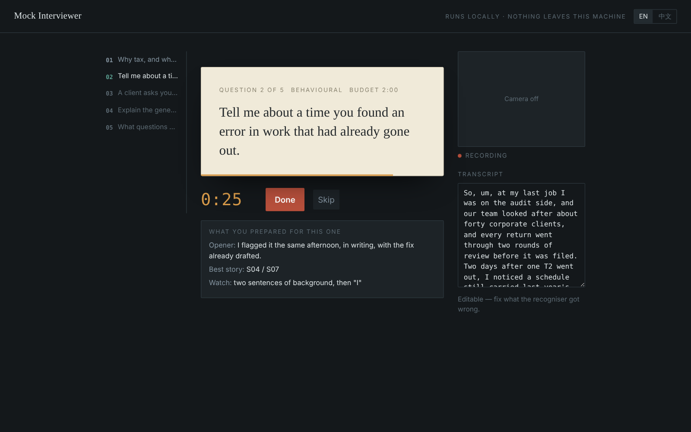

# 发布到 GitHub

从零到上线，大约 15 分钟。

---

## 〇、先填上仓库名

仓库里有个占位符 `github.com/<user>/mock-interviewer`（已替换为 Frikasong），README、安装命令和 skill 正文都引用它。跑一次全换掉：

```bash
python3 build.py --repo 你的用户名/mock-interviewer
```

**这一步必须在推之前做。** 否则用户照着 README 里的 clone 命令会直接失败，照着 skill 里的链接找模拟面试工具会落到 404。

---

## 一、推上去

GitHub 网页新建空仓库，**不要**勾 "Add a README"（本地有了，勾了会冲突）。仓库名建议 `mock-interviewer`。

```bash
cd mock-interviewer
git init
git add .
git commit -m "面试准备三步法：skill（中英）+ Mock Interviewer"
git branch -M main
git remote add origin git@github.com:你的用户名/mock-interviewer.git
git push -u origin main
```

`dist/` 在 `.gitignore` 里，构建物走 Release 不进仓库。

## 二、发第一个版本

```bash
git tag v1.0.0
git push origin v1.0.0
```

推 tag 触发 `.github/workflows/release.yml`：自动构建两个 `.skill` 和 `index.html`，建好 Release。等一两分钟去 Releases 页面看。

以后发新版就是改完推 main、再打个新 tag，不用手动打包。

## 三、仓库设置

About 那个齿轮里：

- **Description**：`面试准备三步法：一个 Claude skill（中英）+ 一个本地模拟面试工具 / Interview prep in three steps`
- **Topics**：`claude-skill` `claude-code` `interview-preparation` `job-search` `ai-tools` `career` `star-method`
- 关掉 Packages、Environments，页面干净些

Topics 是 GitHub 站内唯一的自然流量来源，别跳过。

---

## 四、这一步别省：放图

**README 顶部必须有一张图。** 没图的工具仓库转化差一个量级——尤其你的流量是从视频来的，那批人已经看过界面了，落地页没有图会有「是不是点错了」的落差。

放什么：Mock Interviewer 那张题卡的界面。暗背景、暖色题卡、下沿的计时条，是整个项目最有辨识度的一帧。录视频时顺手截一张。

把截图存成 `docs/screenshot.png`，然后在两个 README 的第一段下面各加一行：

```markdown

```

图宽 1200–1600px。暗色截图在 GitHub 深色主题下也好看。

---

## 五、发布前检查

- [ ] `build.py --repo ...` 跑过，全仓库搜不到 `<user>`
- [ ] `./install.sh` 真的跑通了，确认 `~/.claude/skills` 路径对
- [ ] LICENSE 里是你的名字
- [ ] 两个 `.skill` 装上后能被口语化的请求触发（不要用「帮我用这个 skill」测，那是作弊）
- [ ] `index.html` 在 Chrome 里跑通一整场，复盘导得出来
- [ ] 仓库里没有你自己的面试材料：`git log --all --name-only | sort -u` 扫一遍
- [ ] README 顶部有图

---

## 六、视频的收尾要改

原稿最后一句是「skill 和工具放评论区了」。走 GitHub 要改成更具体的落点，否则观众不知道去哪：

> 完整方法我写成了一个 Claude skill，模拟面试工具也开源了，GitHub 搜 mock-interviewer，评论区我也放链接。

两点判断：

**仓库名要能被念出来、拼得出来。** `mock-interviewer` 可以；加下划线或缩写就不行——视频里没人会暂停截图。

**评论区还是要放链接。** 小红书正文里的链接不可点，但评论区可以，而且置顶评论的到达率比正文尾部高。

---

## 附：RED Skill（粉丝够 1000 之后）

开通要求：粉丝 ≥1000、注册 ≥6 个月、无违规、实名认证。

够了之后：

```bash
python3 build.py --redskill
```

产出 `dist/redskill/`，上传步骤和表单内容见 [`docs/redskill-upload.md`](docs/redskill-upload.md)。

那条路的转化比 GitHub 高一个量级——组件是点两下装好，GitHub 要跳出 App。粉丝到线了记得回来补这一步，不用重做任何东西。
