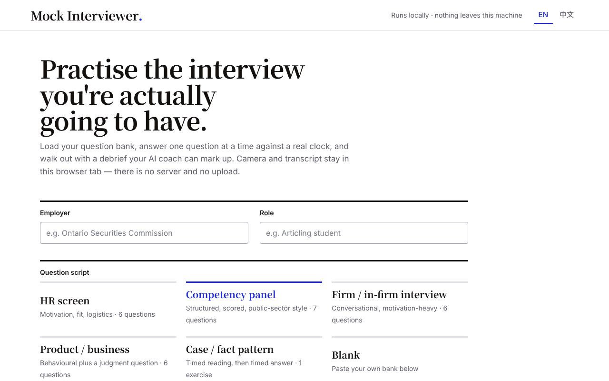

# Mock Interviewer

English · [中文](README.zh.md)



Two things that work together, and work separately.

1. **A method your AI follows** — as an Agent Skill, an MCP server, or a single file you paste into any chat. It builds the two research assets that make interview preparation actually work: an employer dossier with a defensible *why them*, and a STAR story bank with the evidence behind *why me*. Available in English and 中文.
2. **The interviewer** (`interviewer/index.html`) — a single HTML file you open in Chrome to practise against a real clock, with video, transcript, and a debrief your AI coach can mark up.

The premise behind both: **interview outcomes turn on fit, and an AI can only say something useful about fit if it can read real material about you and about them.** Ask a model to "run a mock interview" cold and it produces answers that fit any candidate and any employer — which is exactly what loses interviews. So the skill produces material first, and the interviewer measures your performance against it.

---

## Quick start: one command

Install [uv](https://docs.astral.sh/uv/) once (`brew install uv`, or `curl -LsSf https://astral.sh/uv/install.sh | sh` on macOS and Linux, or `powershell -c "irm https://astral.sh/uv/install.ps1 | iex"` on Windows). Then:

```bash
uv tool install git+https://github.com/Frikasong/mock-interviewer
mock-interviewer
```

The second line opens the practice room in your browser. It runs on your computer at `http://localhost:5757`, and Ctrl+C stops it. To try it without installing, run `uvx --from git+https://github.com/Frikasong/mock-interviewer mock-interviewer` instead.

The same command does everything else:

| Command | What it does |
|---|---|
| `mock-interviewer` | Open the practice room |
| `mock-interviewer skill` | Install the skill into every AI agent found on this computer (or name some: `skill codex gemini`) |
| `mock-interviewer prompt` | Save the one-file version, to paste into any chat AI |
| `mock-interviewer folder "Harbourline LLP" "Tax articling"` | Start a prep folder from the templates |
| `mock-interviewer check question-bank.md` | Check a question bank before you practise |
| `mock-interviewer debrief debrief.md` | Read times, budgets and self-marks out of a debrief |
| `mock-interviewer mcp` | Run the MCP server |

Add `--zh` for the Chinese edition. `mock-interviewer --help` lists every option. Later, `uv tool upgrade mock-interviewer-mcp` updates it.

## Use it with any AI

The method is plain markdown, so it works with whichever assistant you already use. Pick the row that matches it:

| Your AI | Use | Set-up |
|---|---|---|
| A chat website or app: ChatGPT, Gemini, Claude.ai, Copilot, DeepSeek, Kimi, Qwen, Doubao… | the **single file** | none — paste it |
| An agent that reads Agent Skills: Claude Code, Codex, Gemini CLI, GitHub Copilot, Cursor, OpenCode, Goose, Amp, Windsurf | the **skill** | one command |
| Anything that connects to MCP servers: Claude Desktop, Cursor, Codex, Gemini CLI, VS Code, Goose… | the **MCP server** | a few lines of config |

### Single file (any chat)

Download [`portable/interview-prep.md`](portable/interview-prep.md) (中文：[`portable/interview-prep-zh.md`](portable/interview-prep-zh.md)) and paste the whole file in as your first message, or save it as the instructions of a custom GPT, Gem or project. Then describe your situation. It contains the full method and every template; nothing else is needed.

### Skill (agents that read SKILL.md)

```bash
git clone https://github.com/Frikasong/mock-interviewer.git
cd mock-interviewer
./install.sh en                 # into every supported agent found on this computer
./install.sh en codex gemini    # or only the ones you name
./install.sh --list             # supported agents and the folder each one reads
```

Leave off `en` for the Chinese edition, and install one edition per agent — the two answer the same requests. For a tool not on the list, `./install.sh en --dir <its skills folder>`. The skills follow the standard `skills/<name>/SKILL.md` layout, so skill managers that install from a GitHub repo should pick them up as well. Restart the agent, then describe your situation rather than naming the skill: *"I'm interviewing at Tidewater Outfitters for a product marketing role next Thursday, here's the posting."*

**Claude.ai** can also take the `.skill` file from [Releases](../../releases), uploaded under Settings → Capabilities → Skills.

### MCP server

Needs [uv](https://docs.astral.sh/uv/). Add the server to your client's MCP configuration; most clients use this shape:

```json
{
  "mcpServers": {
    "mock-interviewer": {
      "command": "uvx",
      "args": ["--from", "git+https://github.com/Frikasong/mock-interviewer", "mock-interviewer-mcp"]
    }
  }
}
```

Codex (`~/.codex/config.toml`):

```toml
[mcp_servers.mock-interviewer]
command = "uvx"
args = ["--from", "git+https://github.com/Frikasong/mock-interviewer", "mock-interviewer-mcp"]
```

Claude Code: `claude mcp add mock-interviewer -- uvx --from git+https://github.com/Frikasong/mock-interviewer mock-interviewer-mcp`

The server runs on your computer, calls no model and no network service, and offers five tools:

| Tool | What it does |
|---|---|
| `interview_prep_guide` | The method itself — the overview, or step 1, 2 or 3, in English or Chinese. The AI calls this first. |
| `get_template` | A blank template for any of the prep files. |
| `check_question_bank` | Checks a question bank with the interviewer's own parsing rules: how many questions will load, budgets it can't read, ignored fields, duplicates, questions with nothing prepared. |
| `read_debrief` | Reads the times, budgets and self-marks out of an exported debrief and lists the questions to re-run, so the AI marks from exact numbers. |
| `create_prep_folder` | Creates the working folder for one application, filled with blank templates. Never overwrites a file. |

Clients that show MCP prompts also get `interview_prep` and `mark_debrief`.

## Run the interviewer

Download [`interviewer/index.html`](interviewer/index.html) and open it
in Chrome. That is the entire installation procedure — no Node, no server, no API key, no
account. See [its README](interviewer/README.md) for the question format and
browser support.

An illustrated interviewer reads each question and listens while you answer. On its own it is just a drawing: nothing leaves your computer. If you want it to think, open **AI interviewer (optional)** on the setup page and connect any service with an OpenAI-style API — OpenAI, Claude, Gemini, DeepSeek, Kimi, Qwen, Doubao, OpenRouter, a local model through Ollama, or your own address. It will then ask one follow-up after each answer, the way a real panel does, and can mark the debrief for you. Your key stays in that tab unless you tick "remember"; while connected, the page says exactly who your answers are going to, and video and audio are never sent.

---

## How they fit together

```
   skill                                  interviewer
   ─────                                  ───────────
   step 1  employer research  ──┐
           dossier, why-them    │
           question-bank.md  ───┼──────────►  loads directly
                                │            (### question + fields)
   step 2  self research      ──┤
           story cards S01…   ───┼──────────►  pasted as "what you prepared"
           selling points       │
                                │
   step 3  mark the debrief  ◄──┴──◄──────── debrief.md comes back:
                                             answered badly → back to the bank
                                             new story surfaced → new card
```

Three sessions in, your question bank is more accurate than any published interview report, because it grew around your own weak points rather than someone else's.

## Repository layout

```
mock-interviewer/
├── build.py                    builds every release artifact and portable/
├── DEPLOY.md                   release process
├── skills/
│   ├── interview-prep/         English skill
│   │   ├── SKILL.md
│   │   ├── references/         employer research · story bank · mock & debrief
│   │   └── assets/             blank templates for every output
│   └── interview-prep-zh/      中文版，结构相同
├── interviewer/
│   ├── index.html              the whole tool
│   ├── README.md
│   └── scripts/                five ready-made question banks
├── install.sh                  installs the skill into any agent that reads SKILL.md
├── portable/                   the whole method in one file, for any chat AI (generated by build.py)
├── mock_interviewer_mcp/       the mock-interviewer command and the MCP server
├── pyproject.toml              packaging for the MCP server
├── docs/                       release notes for other channels
└── LICENSE
```

## Design notes

A few decisions worth stating, since they're the ones people usually ask about:

**The skill never writes your experience for you.** It interrogates, structures, and sharpens; the facts have to come from you. A fabricated story survives exactly one follow-up question, and the failure mode is worse than having no story.

**AI in the interviewer is opt-in and yours.** Out of the box it calls nothing: no key, no cost, no recording passing through anyone's inference, and the debrief is a markdown file you can take to whatever assistant you use. Connect one and it adds live follow-ups and marking, using your own key with the provider you chose — never a server of ours, because there isn't one.

**Recordings are never uploaded.** Video and audio live in the browser tab and are discarded when you close it unless you download them first. For a file full of your own unrehearsed interview answers, that is the correct default.

## Licence

MIT — see [LICENSE](LICENSE).
