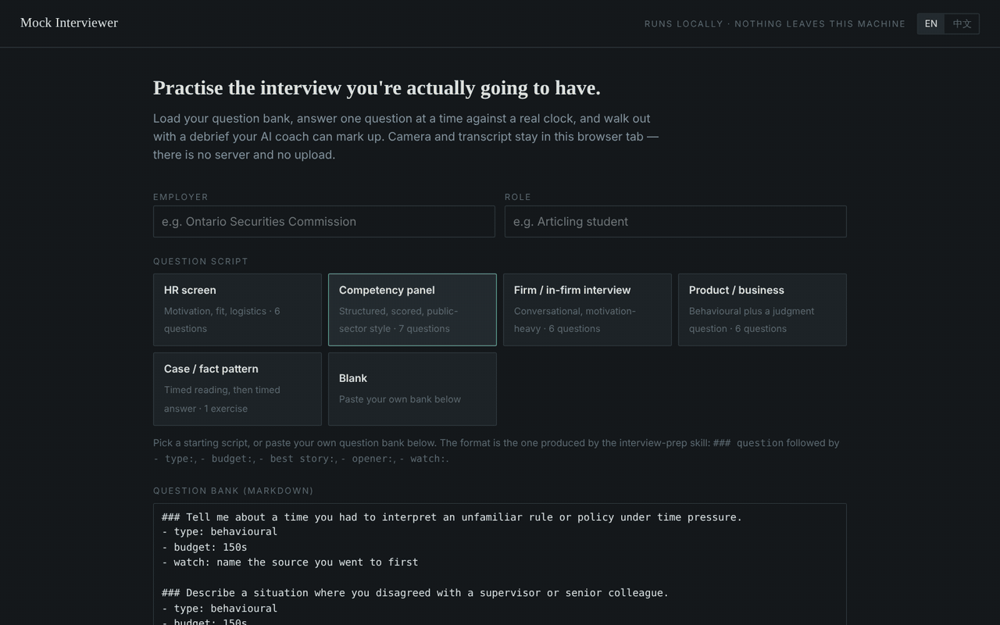

# Mock Interviewer

面试准备三步法

[English](README.md) · 中文



两个东西，配合用最好，分开用也行。

1. **一个 Claude skill**——建面试准备真正需要的两份资料：站得住的雇主档案和 Why Them 论证，以及支撑 Why Me 的 STAR 故事银行。
2. **模拟面试器**（`interviewer/index.html`）——一个 HTML 文件，用 Chrome 打开就能对着真实计时练习，带录像和转录，导出的复盘可以直接交给 AI 批改。

---

## 为什么不是一句 prompt

如果你打开 AI 的第一句话是「帮我模拟一下面试」，这次模拟基本是白做的。

因为它既不知道你是谁，也不知道对面是谁。它只能给你一套对所有候选人、所有雇主都成立的万能答案——而万能答案就是面试失败的原因。

所以顺序是反过来的：**先建资料，最后才练。**

| 步骤 | 解决什么 | 产出 |
|---|---|---|
| 一、调研岗位 | 他们是谁、到底在考什么 | 公司档案、Why Them、题库 |
| 二、认识自己 | 我是谁、我的证据在哪 | STAR 故事卡 S01…Sn、卖点矩阵、自我介绍、弱项 |
| 三、模拟面试 | 把资料变成临场表现 | 缺口清单、逐题复盘 |

前两步是 skill 做的。第三步分两半：工具负责计时、录像和转录，导出的复盘再交回 skill 批改，并回填进题库和故事卡。

有了前两步的资料，AI 才说得出这种话：

> 这题你准备的是 S07，但你临场用了一个更弱的例子。

通用 AI 说不出来，因为它不知道你准备过什么。

---

## 安装 skill

```bash
git clone https://github.com/Frikasong/mock-interviewer.git
cd mock-interviewer
./install.sh
```

装的是中文版。要英文版：`./install.sh en`。**两个只装一个**，会互相抢触发。

装完重启 Claude Code，然后**不要**点名这个 skill——直接说你的情况：

```
我下周四面 XX 公司的 XX 岗，这是 job posting
（把招聘启事粘上）
```

它会自己认出来该干什么。

**用 Claude.ai 网页版的**：去 [Releases](../../releases) 下载 `interview-prep-zh.skill`，在 设置 → Capabilities → Skills 里上传。

**不想装的**：`skills/interview-prep-zh/SKILL.md` 整份粘进对话也能用，只是每次都要粘一遍。

## 运行模拟面试器

下载 [`interviewer/index.html`](interviewer/index.html)，用 Chrome 打开。

安装步骤到此结束。不用装 Node，不用起服务器，不用 API key，不用注册。

---

## 它具体做什么

**第一步·调研岗位**

逐行拆 job description——JD 不是招聘广告，是题纲。写了「和设计、供应链一起推进上新」，后面跟着的就是「讲一次三个团队要三种时间线」。

然后建公司档案（重点是最近 12 个月发生了什么），写 Why Them 三层论证，最后建题库。

Why Them 有一条自检：**把公司名遮掉，这段话如果原封不动能投给它的竞争对手，就是没准备好。** skill 写完会自己跑这个测试。

**第二步·认识自己**

它扮演面试官，对着你简历上的**每一行**提问——不是挑重点，是每一行，因为你猜不到面试官会对哪段感兴趣。

这一步值得你花一个下午。答完之后它把你的回答拆成 10-15 张编号的 STAR 卡。

到这里你手上有的不是答案，是资料。这是它和一句 prompt 最大的区别。

**第三步·模拟面试**

题库和故事库导进工具，一次一题、有计时、有录像。每题的时间预算烧在题卡下沿那条线上；前 15 秒提醒你先给结论。

结束导出复盘，把你**准备的**开场句和最优素材，跟你**实际说的**逐题并排。这份文件顶部已经写好了给 AI 教练的 prompt，粘过去就能批改。

---

## 三个设计判断

**skill 不替你编经历。** 它提问、结构化、润色，事实必须来自你。编出来的故事撑不过一次追问，而且比没故事更糟。

**工具里不含 AI。** 不要 key、不花钱、你的录像不经过任何人的推理服务。复盘是一个 markdown 文件，交给你自己那个 AI。

**什么都不上传。** 录像、音频、转录只存在浏览器标签页里，关掉就没了，除非你先下载。对一堆你自己没打磨过的面试回答来说，这是唯一正确的默认值。

---

## 许可

MIT。随便用、随便改、fork 了署自己名字也行。只求别发一个偷偷上传用户录像的版本。
