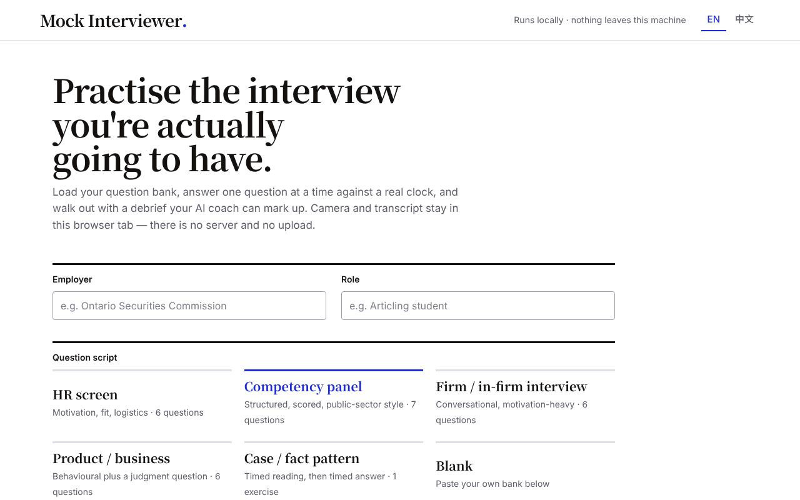

# Mock Interviewer

面试准备三步法

[English](README.md) · 中文



两个东西，配合用最好，分开用也行。

1. **一套任何 AI 都能照着做的方法**——可以是 Agent Skill、MCP 服务器，或者一个粘贴进任何聊天框就能用的单文件。它建面试准备真正需要的两份资料：站得住的雇主档案和 Why Them 论证，以及支撑 Why Me 的 STAR 故事银行。
2. **模拟面试器**（`interviewer/index.html`）——一个 HTML 文件，用 Chrome 打开就能对着真实计时练习，带录像和转录，导出的复盘可以直接交给 AI 批改。

---

## 为什么不是一句 prompt

如果你打开 AI 的第一句话是「帮我模拟一下面试」，这次模拟基本是白做的。

因为它既不知道你是谁，也不知道对面是谁。它只能给你一套对所有候选人、所有雇主都成立的万能答案——而万能答案就是面试失败的原因。

所以顺序是反过来的：**先建资料，最后才练。**

| 步骤 | 解决什么 | 产出 |
|---|---|---|
| 一、调研岗位 | 他们是谁、到底在考什么 | 公司档案、Why Them、题库 |
| 二、认识自己 | 我是谁、我的证据在哪 | STAR 故事卡 S01…Sn、卖点矩阵、自我介绍、弱项 |
| 三、模拟面试 | 把资料变成临场表现 | 缺口清单、逐题复盘 |

前两步由你的 AI 照着这套方法做。第三步分两半：工具负责计时、录像和转录，导出的复盘再交回 AI 批改，并回填进题库和故事卡。

有了前两步的资料，AI 才说得出这种话：

> 这题你准备的是 S07，但你临场用了一个更弱的例子。

通用 AI 说不出来，因为它不知道你准备过什么。

---

## 接入任何 AI

方法本身是纯 markdown，所以你现在用哪个 AI 都可以。按你的情况选一行：

| 你用的 AI | 用哪个 | 安装 |
|---|---|---|
| 网页或 App 里聊天：ChatGPT、Gemini、Claude.ai、Copilot、DeepSeek、Kimi、通义千问、豆包…… | **单文件** | 不用装，直接粘贴 |
| 能读 Agent Skills 的智能体：Claude Code、Codex、Gemini CLI、GitHub Copilot、Cursor、OpenCode、Goose、Amp、Windsurf | **skill** | 一条命令 |
| 能连 MCP 服务器的客户端：Claude Desktop、Cursor、Codex、Gemini CLI、VS Code、Goose…… | **MCP 服务器** | 几行配置 |

### 单文件（任何聊天 AI）

下载 [`portable/interview-prep-zh.md`](portable/interview-prep-zh.md)（英文版：[`portable/interview-prep.md`](portable/interview-prep.md)），整份作为第一条消息粘贴进去，或者存成自定义 GPT、Gem、项目的指令。然后直接说你的情况。完整方法和所有模板都在这一个文件里。

### Skill（能读 SKILL.md 的智能体）

```bash
git clone https://github.com/Frikasong/mock-interviewer.git
cd mock-interviewer
./install.sh                    # 中文版，装进这台电脑上找到的所有支持的智能体
./install.sh zh codex gemini    # 或者只装你点名的几个
./install.sh --list             # 支持哪些智能体、各自读哪个文件夹
```

要英文版就加 `en`。**每个智能体只装一个语言版本**，两个会互相抢触发。列表里没有的工具：`./install.sh zh --dir <它的 skills 文件夹>`。仓库用的是标准的 `skills/<名字>/SKILL.md` 结构，所以从 GitHub 仓库安装 skill 的管理工具应该也能直接识别。

装完重启，然后**不要**点名这个 skill——直接说你的情况：

```
我下周四面 XX 公司的 XX 岗，这是 job posting
（把招聘启事粘上）
```

它会自己认出来该干什么。

**Claude.ai 网页版**也可以去 [Releases](../../releases) 下载 `interview-prep-zh.skill`，在 设置 → Capabilities → Skills 里上传。

### MCP 服务器

需要先装 [uv](https://docs.astral.sh/uv/)。把下面这段加进你的客户端的 MCP 配置，大多数客户端是这个格式：

```json
{
  "mcpServers": {
    "mock-interviewer": {
      "command": "uvx",
      "args": ["--from", "git+https://github.com/Frikasong/mock-interviewer", "mock-interviewer-mcp"]
    }
  }
}
```

Codex（`~/.codex/config.toml`）：

```toml
[mcp_servers.mock-interviewer]
command = "uvx"
args = ["--from", "git+https://github.com/Frikasong/mock-interviewer", "mock-interviewer-mcp"]
```

Claude Code：`claude mcp add mock-interviewer -- uvx --from git+https://github.com/Frikasong/mock-interviewer mock-interviewer-mcp`

服务器在你自己电脑上运行，不调用任何模型，也不联网。提供五个工具：

| 工具 | 做什么 |
|---|---|
| `interview_prep_guide` | 方法本身：总览，或第一、二、三步，中英文都有。AI 会先调用它。 |
| `get_template` | 任一产出文件的空白模板。 |
| `check_question_bank` | 用模拟面试器自己的解析规则检查题库：能导入几道题、哪些时间预算读不懂、哪些字段会被忽略、有没有重复题、哪些题还没准备素材。 |
| `read_debrief` | 从导出的复盘里读出每题用时、预算和自评，列出最该重练的题，让 AI 按准确的数字批改。 |
| `create_prep_folder` | 为一次申请建好工作文件夹，放好空白模板。不会覆盖已有文件。 |

支持 MCP 提示词的客户端还能看到 `interview_prep` 和 `mark_debrief` 两个快捷入口。

## 运行模拟面试器

下载 [`interviewer/index.html`](interviewer/index.html)，用 Chrome 打开。

安装步骤到此结束。不用装 Node，不用起服务器，不用 API key，不用注册。

---

## 它具体做什么

**第一步·调研岗位**

逐行拆 job description——JD 不是招聘广告，是题纲。写了「和设计、供应链一起推进上新」，后面跟着的就是「讲一次三个团队要三种时间线」。

然后建公司档案（重点是最近 12 个月发生了什么），写 Why Them 三层论证，最后建题库。

Why Them 有一条自检：**把公司名遮掉，这段话如果原封不动能投给它的竞争对手，就是没准备好。** AI 写完会自己跑这个测试。

**第二步·认识自己**

它扮演面试官，对着你简历上的**每一行**提问——不是挑重点，是每一行，因为你猜不到面试官会对哪段感兴趣。

这一步值得你花一个下午。答完之后它把你的回答拆成 10-15 张编号的 STAR 卡。

到这里你手上有的不是答案，是资料。这是它和一句 prompt 最大的区别。

**第三步·模拟面试**

题库和故事库导进工具，一次一题、有计时、有录像。每题的时间预算烧在题卡下沿那条线上；前 15 秒提醒你先给结论。

结束导出复盘，把你**准备的**开场句和最优素材，跟你**实际说的**逐题并排。这份文件顶部已经写好了给 AI 教练的 prompt，粘过去就能批改。

---

## 三个设计判断

**这套方法不替你编经历。** 它提问、结构化、润色，事实必须来自你。编出来的故事撑不过一次追问，而且比没故事更糟。

**工具里不含 AI。** 不要 key、不花钱、你的录像不经过任何人的推理服务。复盘是一个 markdown 文件，交给你自己那个 AI。

**什么都不上传。** 录像、音频、转录只存在浏览器标签页里，关掉就没了，除非你先下载。对一堆你自己没打磨过的面试回答来说，这是唯一正确的默认值。

---

## 许可

MIT。随便用、随便改、fork 了署自己名字也行。只求别发一个偷偷上传用户录像的版本。
